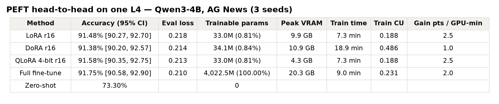
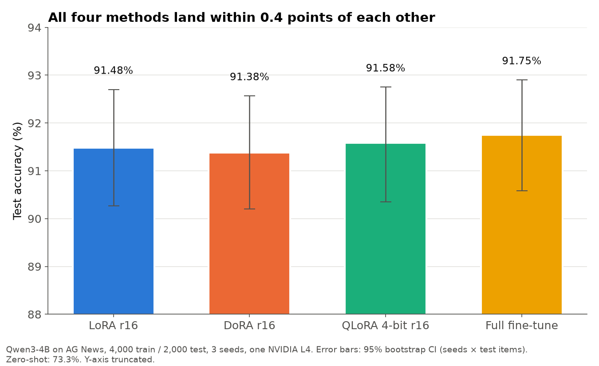
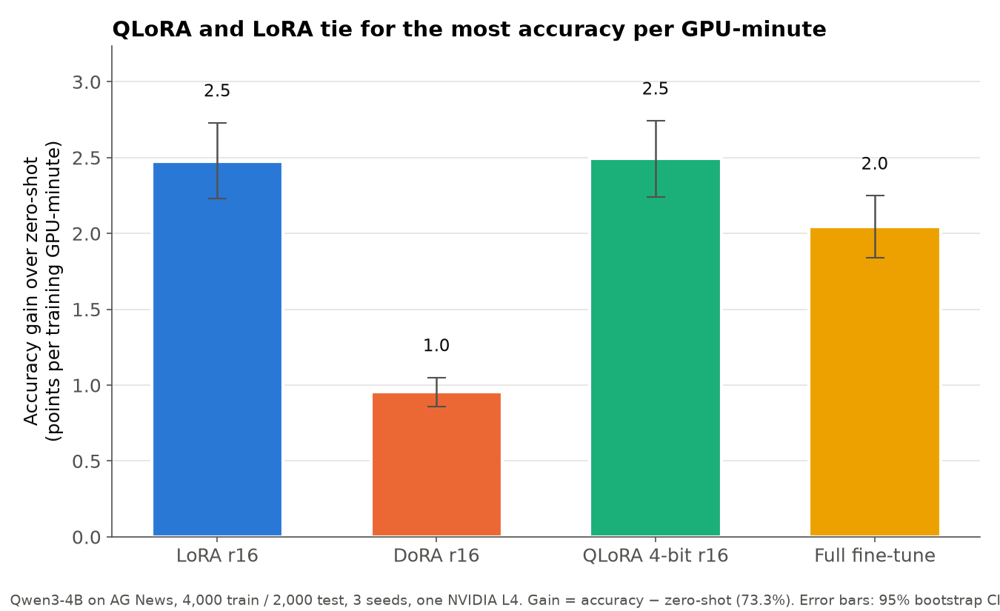

TITLE: LoRA vs DoRA vs QLoRA vs full fine-tuning on one L4: QLoRA is free memory, DoRA is not free speed
SUBTITLE: Qwen3-4B on AG News, three seeds per method. Accuracy ended in a four-way tie, so the real differences are cost.

Which parameter-efficient method should you pick? I ran LoRA, DoRA, QLoRA and full fine-tuning on the same model and data, on one Colab L4, and looked at accuracy, memory and time. I had two predeclared claims: DoRA beats LoRA by between 0 and 1 point, and QLoRA stays within 1 point of LoRA at no more than 60% of the VRAM.

Verdict: INCONCLUSIVE overall. QLoRA matched LoRA at 0.44 times the memory, so that claim is supported. DoRA did not beat LoRA, but its interval still crosses zero, so I cannot call it worse either.

Setup

Model: Qwen/Qwen3-4B. Data: AG News, 4,000 training and 2,000 test articles. Each run was 250 steps at batch size 16, with 3 seeds (1234 to 1236) per method. Accuracy is the argmax over the summed log-probabilities of the four label strings. The zero-shot baseline was 73.30%.

Full fine-tuning fit on the L4 using bf16 weights and 8-bit AdamW with the optimizer step done during the backward pass, so I did not need to fall back to a smaller model. GPU: one NVIDIA L4 on Colab. The kept runs used about 5.2 CU. Counting four VMs, three of which were lost to restarts of the local monitoring machine, session time was roughly 6.8 to 10.2 CU.

Results

Mean accuracy over 3 seeds, with 95% CI: LoRA r16 91.48% (90.27 to 92.70), DoRA r16 91.38% (90.20 to 92.57), QLoRA 4-bit r16 91.58% (90.35 to 92.75), full fine-tune 91.75% (90.58 to 92.90).

The best and worst are 0.37 points apart. Every paired interval includes zero. DoRA minus LoRA was -0.10 points (CI -0.47 to +0.30). QLoRA minus LoRA was +0.10 (CI -0.35 to +0.55). Full minus LoRA was +0.27 (CI -0.22 to +0.77).

The cost is where they differ

Peak VRAM allocated: QLoRA 4.3 GB, LoRA 9.9 GB, DoRA 10.9 GB, full fine-tune 20.3 GB. Training time: LoRA 7.3 minutes, QLoRA 7.3 minutes, DoRA 18.9 minutes, full 9.0 minutes.

I expected QLoRA's 4-bit dequantization to slow it down. On the L4 it did not: same wall-clock as LoRA, less than half the memory. DoRA took 2.6 times longer to train for no measured accuracy gain. In PEFT's unmerged form it also evaluated 1.8 times slower.

Accuracy per training GPU-minute (gain over zero-shot divided by training minutes): QLoRA 2.49 (CI 2.24 to 2.74), LoRA 2.48 (CI 2.23 to 2.73), full 2.05 (CI 1.84 to 2.25), DoRA 0.95 (CI 0.86 to 1.05). QLoRA and LoRA are a statistical tie. QLoRA's real advantage is memory.

Verdict

INCONCLUSIVE overall: H1 (DoRA beats LoRA) is neither supported nor contradicted, and H2 (QLoRA matches LoRA at 60% VRAM or less) is supported. The data does rule out a DoRA gain larger than about 0.3 points on this task.

Caveats

AG News is an easy task, and every method lands at 91 to 92%. A harder task, like reasoning or long-form generation, could separate them. Each method used one untuned learning rate (2e-4 for adapters, 1e-5 for full), fixed in advance. My full fine-tune is not textbook: bf16 weights, 8-bit AdamW with stochastic rounding, and no gradient clipping. It peaks at 20.3 GB, right at the edge of the L4, and one seed hit a fragmentation OOM and needed the expandable_segments setting. DoRA's speed penalty depends on PEFT's implementation, which recomputes weight norms each step. Runs spanned four Colab L4 VMs. The intervals combine seed and item resampling across only 3 seeds, so the seed part is coarse.

What to try next

A harder downstream task, a learning-rate sweep per method, and a bigger model where QLoRA's memory savings decide whether the run fits at all.

All code, per-seed predictions and logs are in the experiment folder. If you want more measured tests like this, subscribe to Tech in General.
